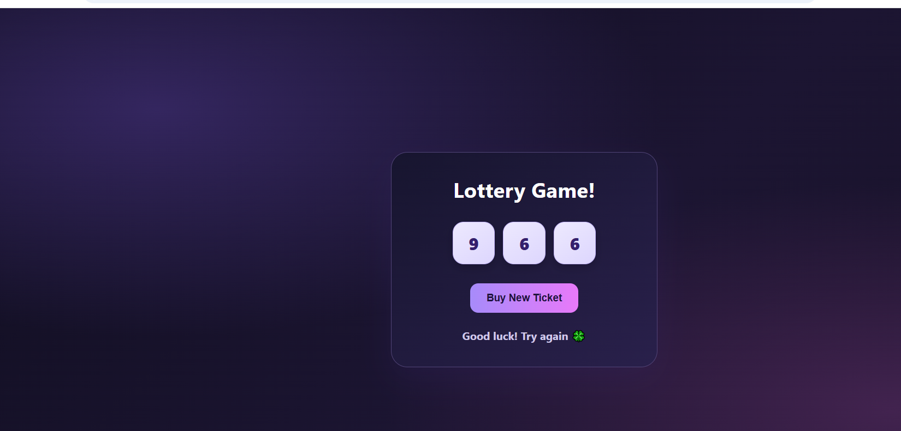

# 🎟️ Lottery Game

A simple and interactive Lottery Game built using **React.js**. Generate random lottery tickets, check the result, and try your luck!

## 📸 Screenshot



## ✨ Features

- 🎲 Generates a random ticket with three numbers.
- 🔄 Buy a new ticket with one click.
- 🏆 Automatically checks the winning condition.
- 🎉 Displays a winning message when the sum of the ticket numbers equals 15.
- 🍀 Shows an encouraging message when the ticket does not win.
- 🎨 Attractive dark-themed user interface.

## 🛠️ Tech Stack

- React.js
- JavaScript (ES6)
- HTML5
- CSS3
- Vite

## 🚀 Getting Started

### Prerequisites

Install [Node.js](https://nodejs.org/) before running the project.

### Installation

**1. Clone the repository**

```bash
git clone https://github.com/devbyMadhu99/Lottery-Game.git
```

**2. Navigate to the project folder**

```bash
cd Lottery-Game
```

**3. Install dependencies**

```bash
npm install
```

**4. Start the development server**

```bash
npm run dev
```

Open the local URL displayed in your terminal.

## 🎮 How to Play

1. View the three randomly generated ticket numbers.
2. The game checks whether their sum equals 15.
3. If the sum is 15, you win!
4. Click **Buy New Ticket** to generate another ticket.

## 📚 What I Learned

- React components and props
- State management using `useState`
- Random number generation in JavaScript
- Array methods such as `reduce()`
- Conditional rendering
- Styling React components using CSS

## 👩‍💻 Author

**Madhu Yadav**

- GitHub: [@devbyMadhu99](https://github.com/devbyMadhu99)

---

⭐ If you like this project, consider giving it a star!
